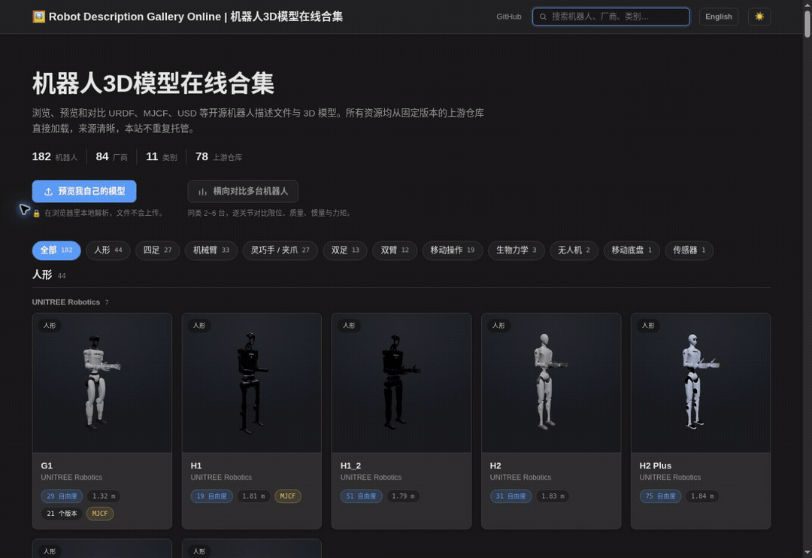

# Robot Description Gallery Online

机器人模型在线图库 / Interactive robot description gallery (URDF · MJCF).

[](https://imchong.github.io/Robot_Description_Gallery_Online/web/)
[](https://github.com/ImChong/Robot_Description_Gallery_Online/actions/workflows/pages.yml)
[](LICENSE)

[](https://imchong.github.io/Robot_Description_Gallery_Online/web/)

**[打开在线图库](https://imchong.github.io/Robot_Description_Gallery_Online/web/)** · 分类检索 · 3D 关节交互 · 多机型对比 · 模型下载

支持本地导入 URDF、xacro、MJCF 和 USD；文件仅在浏览器中解析，不会上传。

## 本地运行

```bash
npm install
npm run dev
```

访问 <http://localhost:8080/web/>。无需构建。

代码采用 [MIT License](LICENSE)；机器人模型遵循各自上游许可证。
